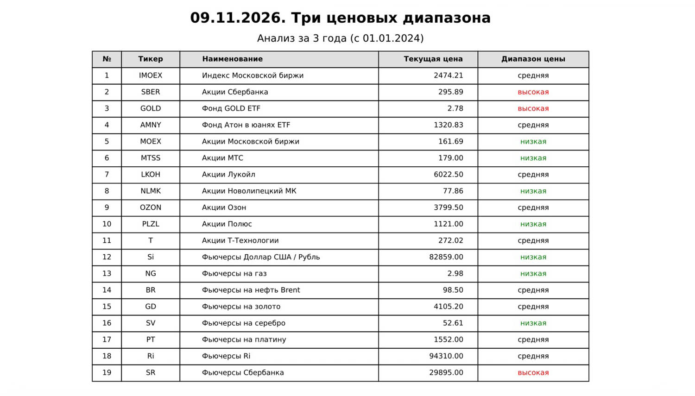
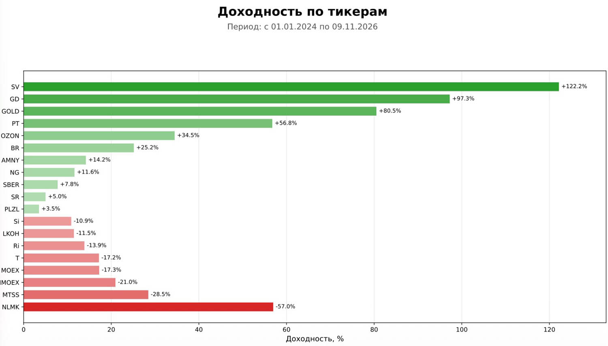
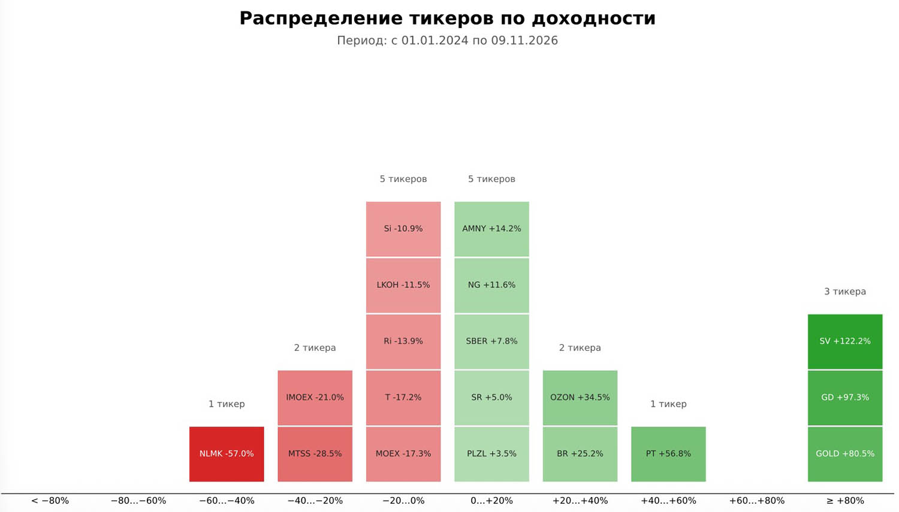
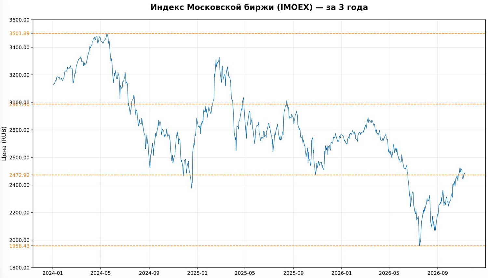

<div align="center">

**[🇷🇺 Русский](./README_RU.md) • 🇬🇧 English**

</div>

# Three Prices (3price)

**Any information generated by this software (its algorithms) does not constitute an individual investment recommendation. You make financial decisions on your own and at your own risk.**

*This software is provided "as is", without warranty of any kind, express or implied, including but not limited to the warranties of merchantability, fitness for a particular purpose, and noninfringement. In no event shall the authors or copyright holders be liable for any claim, damages, or other liability arising from, out of, or in connection with this software or its use.*

This code was created with the help of an LLM (Large Language Model) assistant.


A system for analyzing the prices of financial assets: for each instrument, the system determines which of **three price ranges** its current price falls into, computes the return over the period, and generates a PDF report with a summary table and charts. The configuration file (Config) lists the tickers and descriptions of the assets of the selected market: the Moscow Exchange (`COUNTRY = 'RF'`) or US exchanges (`COUNTRY = 'USA'`).

The code can be used to analyze any financial asset by changing the ticker and its description. The `txt` folder must contain the data downloaded for that asset (with `DOWNLOAD_MOEX = True` or `DOWNLOAD_USA = True` the system downloads it itself for the selected market).

## 🖼️ Report samples

<div align="center">
&nbsp;
</div>
<div align="center">
&nbsp;
</div>

The "Three Prices" logic is simple:

1. Closing-price history is taken for the analysis period — `YEARS` calendar
   years in total, including the current one: from January 1 of
   `(current year − (YEARS − 1))` to today.
2. Over this history the price minimum and maximum are computed; the
   `[min … max]` range is split into three equal parts by the levels
   `min + ⅓·range` and `min + ⅔·range`.
3. The current price (the latest available date) is classified:

   | Condition               | Label     | Table color |
   |-------------------------|-----------|-------------|
   | price ≤ ⅓ of the range  | `low`     | green       |
   | price ≤ ⅔ of the range  | `medium`  | black       |
   | price above ⅔           | `high`    | red         |

   If the data contains no valid price at all, the label is `—` in gray.

The idea is a rough but visual estimate of how "expensive" an instrument looks
relative to its own multi-year history, with no reference to fundamentals.

---

## Project layout

```
3price/
├── main.py           # entry point: orchestration only
├── config.py         # all configurable parameters and the asset lists
├── log_setup.py      # logging setup and the startup banner
├── data_loader.py    # reads quotes from txt/ → {ticker: DataFrame}
├── analysis.py       # "three prices" levels and color labels (pure functions)
├── report.py         # PDF: title with the table, returns, distribution, charts
├── moex_loader.py    # downloads fresh quotes from MOEX ISS into txt/ (see DOWNLOAD_MOEX)
├── usa_loader.py     # downloads fresh US quotes from Yahoo Finance into txt/ (see DOWNLOAD_USA)
├── txt/              # INPUT data — quote files (refreshed automatically with DOWNLOAD_MOEX / DOWNLOAD_USA)
├── logs/             # run logs (created automatically)
├── reports/          # ready PDF reports (created automatically)
└── docs/             # illustrations for the README
```

---

## Requirements and running

- Python **3.10+** (uses the `str | None`, `dict[str, ...]` syntax).
- Libraries: `pandas`, `matplotlib`; for MOEX downloads — `requests`,
  for Yahoo Finance — `yfinance`:

  ```bash
  pip install pandas matplotlib requests yfinance
  ```

Run from the project folder:

```bash
python3 main.py
```

What happens on launch:

1. Run parameters are computed (dates, file names) — see `config.py`.
2. Logging is set up (file + console) and the startup banner is printed.
3. If the download flag of the current country is on (`DOWNLOAD_MOEX` or
   `DOWNLOAD_USA`), fresh quotes are downloaded into `txt/` (a full MOEX
   download takes ≈2.5 minutes; on failures the previous files are kept).
4. Quotes are read from the `txt/` folder and filtered by the start date.
5. For every ticker the levels and range labels, the return over the period,
   and the return distribution are computed.
6. The PDF is written to `reports/`; the `logs/` and `reports/` folders are
   created automatically.

Return codes: `0` — the report was built; `1` — no ticker survived the
filtering (the log receives `[ERROR] Нет данных для сохранения в PDF…` —
"No data to save to PDF").

Console output example (the program prints its log messages in Russian;
they are shown here as-is):

```
[INFO] Успешно прочитан файл: RF-SBER-d-5y.txt (247 строк начиная с 2026-01-01)
[ERROR] В файле RF-T-d-5y.txt не найдены колонки даты или цены. Доступные: ['foo', 'bar']
[INFO] Проанализировано: 21 тикер

================================================
[2026-11-10 10:00:00] 🚀 Запуск системы "Три цены" 3price.
================================================
[2026-11-10 10:00:02] ✅ Готово: 2026-11-10-3price-RF-1.pdf — сохранён в папке reports
```

(Log lines go to both the file and the console; the order in the example may
differ due to stdout buffering when the output is redirected.)

---

## Modules

### `main.py` — entry point

Sequence of steps: `build_run_params()` → `setup_logging()` → `write_banner()`
→ the asset list and the download source are selected by `COUNTRY` (`'RF'` →
`ASSETS_CONFIG_RF` + `DOWNLOAD_MOEX`/`moex_loader`, `'USA'` →
`ASSETS_CONFIG_USA` + `DOWNLOAD_USA`/`usa_loader`; an unknown value exits with
code 1) → if the download flag of the current country is on —
`download_…_data()` → `load_data()` → `build_price_maps()` → early exit with
code 1 if the data is empty → `generate_pdf()` → the final "Done" line written
to the log and console.
The module is safe to import — no code runs on `import main`.

### `config.py` — configuration

All project constants and the asset dictionaries `ASSETS_CONFIG_RF` /
`ASSETS_CONFIG_USA` (selected by `COUNTRY`). The `build_run_params()` function
assembles `RunParams` (a named set of run parameters: `years`, `today_str`,
`pdf_filename`, `log_filename`, `start_date`) and has no other side effects.
The analysis period is `YEARS` calendar years in total, including the current
one: the start date is computed as `January 1 (current year − (YEARS − 1))`.

### `log_setup.py` — logging

- `setup_logging(logs_folder, log_filename)` — creates the logs folder, sets up
  simultaneous output to a file (UTF-8) and to the console in the
  `[LEVEL] message` format, and returns the path to the log file.
- `write_banner(log_path)` — the startup banner "🚀 Запуск системы \"Три цены\" 3price",
  written to the log **without** the standard logging prefix.

### `moex_loader.py` — downloading data from MOEX

A port of the `download_moex` project logic. Enabled by the `DOWNLOAD_MOEX`
flag in `config.py`; fresh quotes are written to `txt/` with the country prefix
(`COUNTRY`, e.g. `RF-SBER-d-5y.txt`) and in the same format (TAB:
`Date, Open, High, Low, Close, Volume_lot, Ticker`), after which `data_loader`
reads them as usual.

- Quarterly futures `Si, CR, Ri, GD, SV, PT, SR` — "calendar splicing":
  contracts of the form `TICKER + H/M/U/Z + year digit` are downloaded one by
  one and spliced into a continuous series by expiration dates (the third
  Thursday of the month) → `COUNTRY-TICKER-all-d.txt` (e.g. `RF-Si-all-d.txt`).
- Monthly commodity futures `NG, BR` — "dynamic splicing" by the last trading
  day of each contract → `COUNTRY-TICKER-all-d.txt` (e.g. `RF-BR-all-d.txt`).
- Stocks, funds and the index — daily candles (`interval=24`); for the `IMOEX`
  index the `markets/index` endpoint is used, for everything else
  `markets/shares` → `COUNTRY-TICKER-d-5y.txt` (e.g. `RF-SBER-d-5y.txt`).
- Only tickers from `ASSETS_CONFIG_RF` are processed (the classification
  "quarterly / monthly / stock" is defined in the module).
- Reliability: a retry session repeats on 429/5xx; a failure on one ticker does
  not stop the others; an empty result never overwrites the file — the previous
  data stays in `txt/`, and the report is still built from it.
- The MOEX ISS futures archive lags by about a day (stocks — up to today,
  futures — up to the previous trading day). A full download takes ≈2.5 minutes.
- The download depth is `DOWNLOAD_FROM` (common for both markets, default
  `'2021-01-01'`), with a margin relative to `YEARS`: the analysis period is
  cut off later by `start_date`.
- Without the `requests` package the project keeps working with
  `DOWNLOAD_MOEX = False` — the data is then taken from `txt/` as is.

### `usa_loader.py` — downloading US data (Yahoo Finance)

A port of the `download_us` project. Enabled by the `DOWNLOAD_USA` flag in
`config.py`, only with `COUNTRY = 'USA'`; quotes are downloaded via the
`yfinance` package from Yahoo Finance and written to `txt/` with the country
prefix and in the same format as the MOEX files — TAB
(`Date, Open, High, Low, Close, Volume_lot, Ticker`), after which `data_loader`
reads them as usual.

- Assets from `ASSETS_CONFIG_USA`: stocks and ETFs are downloaded as daily
  OHLCV candles (unadjusted `Close`) → `COUNTRY-TICKER-d-5y.txt` (e.g.
  `USA-NVDA-d-5y.txt`).
- Continuous Yahoo futures (tickers of the form `ZW=F`) are saved under the
  sanitized name → `COUNTRY-ZW-F-all-d.txt` (the splicing into a continuous
  series is done by Yahoo itself).
- The download depth is `DOWNLOAD_FROM` (common with MOEX, default
  `'2021-01-01'`).
- Reliability: a failure on one ticker does not stop the others; an empty
  result never overwrites the file — the previous data stays in `txt/`.
- Yahoo Finance must be reachable from your network; without the `yfinance`
  package the project keeps working with `DOWNLOAD_USA = False` — the data is
  then taken from `txt/` as is.

### `data_loader.py` — data loading

- `load_data(txt_folder, assets_config, start_date, country)` — the main
  function; returns `{ticker: DataFrame}` with the `begin` (date) and `close`
  (closing price) columns. Only files with the country prefix are read:
  `COUNTRY-TICKER-d-5y.txt` / `COUNTRY-TICKER-all-d.txt`.
- `_extract_ticker(file_name, country)` — the ticker from the file name: the
  part between the country prefix (`RF-`) and the `-d-5y.txt` or `-all-d.txt`
  suffix (e.g. `RF-SBER-d-5y.txt` → `SBER`).
- `_parse_price_file(file_path)` — reads a single file:
  - the separator is detected automatically (`sep=None, engine='python'`), so
    TAB, comma, and semicolon all work;
  - column names are lowercased and angle brackets are stripped
    (`<DATE>` → `date`);
  - the date column is looked up among the candidates `begin`, `date`,
    `timestamp`, `time`; the price column — among `close`, `last`, `price`;
  - dates are parsed with `pd.to_datetime`, prices with `pd.to_numeric`; rows
    with NaN are dropped, the data is sorted by date, prices are rounded to
    2 decimal places.

Rules for handling problem files (the system never crashes on a single file):

| Situation | Reaction |
| --- | --- |
| The ticker is not in the selected country's asset list | the file is **silently** skipped |
| Date/price columns not found | `[ERROR] … не найдены колонки даты или цены. Доступные: [...]` ("date or price columns not found. Available: [...]") |
| Other read/parse error | `[ERROR] Ошибка обработки <файл>: <текст>` ("error processing <file>: <text>") |
| Empty after the date filter | `[WARNING] Файл … не содержит данных после …` ("file … contains no data after …") |

If both files exist for the same ticker (`RF-*-d-5y.txt` and `RF-*-all-d.txt`),
both will be read, and the **last** one read wins — i.e. the `RF-*-all-d.txt`
file (the patterns are iterated in that order). Keep only one file per ticker
in `txt/` so you don't have to guess which data made it into the report. Files
without the country prefix (`SBER-d-5y.txt`) are not read — a warning is
logged.

### `analysis.py` — levels and labels

Pure functions without I/O, easy to cover with tests:

- `compute_levels(df)` → `(min, min+⅓·range, min+⅔·range, max)` — the **only**
  levels formula in the project; it is used both by the labels and by the
  dashed chart lines.
- `classify_price(current_price, levels)` → `(label, color)` — the rule from
  the table above; the ⅓ and ⅔ boundaries belong to the lower/middle range.
- `build_price_maps(data_dict)` → `(price_level_map, price_color_map)` — labels
  and colors for all tickers at once.

### `report.py` — PDF report

- `generate_pdf(pdf_path, ...)` — the public entry point: title pages with the
  ticker table, the returns page, the distribution page, then one page per
  ticker **strictly in the order of the selected country's asset list**.
- `_build_table_rows(...)` / `_render_title_pages(...)` — the table
  `№ / Тикер / Наименование / Текущая цена / Диапазон цены`; the text in the
  last column is colored green/black/red/gray by the analysis result. Rows are
  split by `ROWS_PER_PAGE = 20`: with more than twenty tickers the table
  continues onto the following pages without a header.
- `_render_returns_page(...)` / `_build_returns_figure(...)` — the "returns by
  ticker" page: horizontal bars for all tickers over the period, sorted in
  descending order; the bar length follows the absolute return, the sign is
  visible in the "+x.x%" label; profit is green, loss is red, and the color
  saturation grows away from zero (the minimum is `SAT_MIN`).
- `_render_distribution_page(...)` / `_build_distribution_figure(...)` — the
  "ticker return distribution" page: 10 ranges of 20% each (from `< −80%` to
  `≥ +80%`), every column holds labeled ticker cells with a counter above
  (`plural_tickers`); the cell color uses the same scale.
- `_render_ticker_chart(...)` — the price chart with a colored line; the
  `min, ⅓, ⅔, max` levels are drawn as an orange dashed line (`--`), and the
  same values are highlighted in orange on the Y axis.
- `plural_years(n)` — declension of the Russian word "год" (year), with the
  11–14 exceptions handled (one function for the whole project — the title and
  the chart titles).
- `plural_tickers(n)` — declension of the Russian word "тикер" (ticker)
  (counters on the distribution page).
- `_return_color(v, vmax, vmin)` — the single green-red saturation scale for
  the returns and distribution pages.
- `assign_chart_colors(...)` — line colors are assigned to tickers in a round
  robin from `BASE_COLORS` in the asset-list order.

---

## Configurable parameters

All configurable parameters of the project — in a single table; they are set
only in `config.py` (run settings, asset lists, presentation constants).
The actual values are in the project's `config.py`.

| Parameter | Where | Default | What it controls |
| --- | --- | --- | --- |
| `YEARS` | `config.py` | `1` | Analysis depth in years: `YEARS` calendar years in total, including the current one — the period "from January 1 (current year − (YEARS − 1))". Affects data filtering, the title-page subtitle, chart titles, and the PDF name (`…-3price-RF-N.pdf`). |
| `COUNTRY` | `config.py` | `'RF'` | Market of the analysis: `'RF'` — the Russian market (MOEX), `'USA'` — the US market (Yahoo Finance). Also sets the country prefix in file names: `txt/RF-…` / `txt/USA-…`, `reports/…-3price-RF-N.pdf`. |
| `DOWNLOAD_MOEX` | `config.py` | `False` | `True` — download fresh quotes from MOEX ISS into `txt/` before building the report (with `COUNTRY = 'RF'`, see `moex_loader.py`); `False` — work only with the files in `txt/`, without the network. |
| `DOWNLOAD_USA` | `config.py` | `False` | `True` — download fresh US quotes from Yahoo Finance into `txt/` before building the report (with `COUNTRY = 'USA'`, see `usa_loader.py`); `False` — work only with the files in `txt/`, without the network. |
| `DOWNLOAD_FROM` | `config.py` | `'2021-01-01'` | Download depth common for both markets (MOEX and Yahoo Finance): files in `txt/` are written from this date. Keep a margin relative to `YEARS` — the analysis period is cut off later by `start_date`. |
| `TXT_FOLDER` | `config.py` | `'txt'` | Folder with the input quote files. |
| `LOGS_FOLDER` | `config.py` | `'logs'` | Folder for logs (created automatically). |
| `REPORTS_FOLDER` | `config.py` | `'reports'` | Folder for PDF reports (created automatically). |
| `ASSETS_CONFIG_RF` | `config.py` | 21 tickers | The RF asset list, used with `COUNTRY = 'RF'` — see below. |
| `ASSETS_CONFIG_USA` | `config.py` | 28 tickers | The US asset list, used with `COUNTRY = 'USA'` — see below. |
| `LEVEL_COLOR` | `config.py` | `'#ff7f0e'` | Orange color of the dashed levels and their labels on the Y axis. |
| `BASE_COLORS` | `config.py` | 10 colors | Palette of the chart line colors; with more tickers the colors repeat in a round robin. |
| `ROWS_PER_PAGE` | `config.py` | `20` | Ticker-table data rows per title page (the rest continues onto the next page). |
| `SAT_MIN` | `config.py` | `0.35` | Minimum color saturation on the returns and distribution pages: near zero the color is pale but still visible. |
| `GREEN_BASE`, `RED_BASE` | `config.py` | `#2ca02c` / `#d62728` | Base green/red colors of the returns scale. |

### Asset lists `ASSETS_CONFIG_RF` / `ASSETS_CONFIG_USA`

Both lists are dictionaries of the same shape; the report uses the one selected
by `COUNTRY`:

```python
'SBER': {'name': 'Акции Сбербанка', 'currency': 'RUB'},
'NG':   {'name': 'Фьючерсы на газ', 'currency': 'USD'},
```

- The key is the **ticker**, which must exactly match the ticker part of the
  file name in `txt/` — the part between the country prefix (`RF-` / `USA-`)
  and the `-d-5y.txt` / `-all-d.txt` suffix (case matters: `Si` ≠ `SI`).
- `name` — a human-readable name for the table and chart titles.
- `currency` — the Y-axis label of the chart (`Цена (RUB)` / `Цена (USD)` —
  "Price (RUB/USD)"). Currency conversion is **not performed**: the `NG`,
  `BR`, `GD`, `SV`, `PT` futures are shown in dollars, as they appear in the
  data.

**How to add an asset:** add a line to the needed dictionary and put a
`RF-TICKER-d-5y.txt` / `RF-TICKER-all-d.txt` file into `txt/` (or `USA-…` for
the US market). To remove an asset from the report — delete its line from the
dictionary (the file in `txt/` is then simply ignored).

**Asset output order (sorting).** The order of the dictionary keys is the only
thing that determines the order; no automatic sorting (alphabetical, by return,
etc.) is performed. It controls:

- the order of the table rows on the title page;
- the order of the per-ticker chart pages;
- the round-robin assignment of line colors from `BASE_COLORS`.

To change the order — reorder the lines in the dictionary in `config.py`. Two
report pages are sorted differently: "Returns by ticker" — by the return value
(descending), "Ticker return distribution" — by ranges.

### Computed automatically (not configurable)

- `start_date` — January 1 of the year `(current − (YEARS − 1))`;
- the PDF name — `YYYY-MM-DD-3price-RF-N.pdf` (with the `COUNTRY` prefix), by
  the run date;
- the log name — `YYYY-MM-3price.log`, by the run month;
- the range-label colors (green/black/red/gray) — hardcoded in
  `analysis.classify_price`; the green-red returns scale — in `_return_color`
  from the base `GREEN_BASE`/`RED_BASE` (set in `config.py`).

---

## Input data format

The file name in `txt/`: `RF-TICKER-d-5y.txt` / `RF-TICKER-all-d.txt` for the
Russian market and `USA-TICKER-…` for the US market (the prefix = the
`COUNTRY` value). The `-d-5y.txt` suffix — stocks, funds and indices;
`-all-d.txt` — spliced futures (the continuous Yahoo future `ZW=F` is saved as
`USA-ZW-F-all-d.txt`).

Both downloaders write the same format — a text CSV with tabs:

```
Date	Open	High	Low	Close	Volume_lot	Ticker
2026-11-02	342.67	343.8	335.82	338.32	64757700	AAPL
```

With `DOWNLOAD_MOEX = True` (MOEX ISS) or `DOWNLOAD_USA = True` (Yahoo Finance)
the files are refreshed automatically. In manual mode a text CSV with any
separator is enough; two columns are required — the date and the closing price
(the candidates are listed in the `data_loader.py` description); the other
columns (`Open`, `High`, …, `Ticker`) are allowed and ignored.

Content requirements:

- dates — in any format understood by `pandas.to_datetime` (`2020-01-06`,
  `06.01.2020`, `20200106`, etc.);
- prices — numbers; rows with empty/non-numeric values are dropped;
- enough data from `start_date` — everything earlier is filtered out, but if
  not a single row survives the filter, the ticker will not appear in the
  report (a `[WARNING]` is logged);
- data older than `start_date` in the file does no harm — it is cut off at
  load time.

Quote data can be downloaded with the `download_moex` program (RF) and copied
into the `txt` folder — or you can let the system download it itself
(`DOWNLOAD_MOEX = True` / `DOWNLOAD_USA = True`).

## Output files

### `reports/YYYY-MM-DD-3price-RF-N.pdf`

- Page 1 — the title: a header with the date, the subtitle "Analysis for N
  years (from …)", and the table `№ / Тикер / Наименование / Текущая цена /
  Диапазон цены` with a colored range label. With more than 20 tickers the
  table continues onto the following pages (without a header).
- Page 2 — "Returns by ticker": horizontal bars for all tickers over the
  period (sorted in descending order; profit in green, loss in red; the
  saturation grows away from zero), "+x.x%" labels at the bar ends.
- Page 3 — "Ticker return distribution": 10 ranges of 20% each (from `< −80%`
  to `≥ +80%`), every column holds labeled ticker cells with a counter above.
- Then one page per ticker (in the order of the selected country's asset
  list): the price chart over the period with orange dashed
  `min / ⅓ / ⅔ / max` levels.

### `logs/YYYY-MM-3price.log`

The full journal of the month's runs: startup banners, file-reading lines (how
many rows were read and from which date), errors and warnings, the final
"✅ Готово: …" ("Done") line. The log is appended on every run.

---

## Troubleshooting

| Symptom | Cause and what to do |
| --- | --- |
| `[ERROR] Нет данных для сохранения в PDF` (return code 1) | There are no files in `txt/` with tickers from the selected country's asset list, or the folders are not being created — check that you run from the project folder and that the file names match the tickers. |
| `MOEX: … сетевая ошибка / HTTP …` during the download | Connection problems with MOEX ISS: the already downloaded files in `txt/` are kept and the report is built from them — you can rerun later. The download is enabled by the `DOWNLOAD_MOEX = True` flag. |
| `USA: … нет данных / ошибка загрузки` during the download | Yahoo Finance is unreachable from your network (timeout/blocking) or the ticker is wrong: the already downloaded files in `txt/` are kept and the report is built from them — you can rerun later. The download is enabled by the `DOWNLOAD_USA = True` flag with `COUNTRY = 'USA'`. |
| `…не найдены колонки даты или цены. Доступные: ['foo', 'bar']` ("date or price columns not found") | The file has no column with an expected name — rename the column (`<DATE>`/`<CLOSE>`, etc.) or add your own candidate to the `_parse_price_file` list in `data_loader.py`. |
| `Файл … не содержит данных после ГГГГ-ММ-ДД` ("file … contains no data after YYYY-MM-DD") | The file has no quotes for the analysis period — download a longer history. |
| The ticker is in `txt/` but did not appear in the report | The ticker was not added to the asset list, or the name/case does not match (`Si` ≠ `SI`), or the ticker has a competing `*-all-d.txt` file that overrode the data. |
| `ModuleNotFoundError: pandas` | Run with the wrong interpreter: the libraries are installed into a specific Python (on the author's machine — `/usr/local/bin/python3.12`). |
| `ModuleNotFoundError: requests` | The `requests` package is missing while `DOWNLOAD_MOEX = True`: install it (`pip install requests`) or turn the download off (`DOWNLOAD_MOEX = False`). |
| `ModuleNotFoundError: yfinance` | The `yfinance` package is missing while `DOWNLOAD_USA = True`: install it (`pip install yfinance`) or turn the download off (`DOWNLOAD_USA = False`). |
