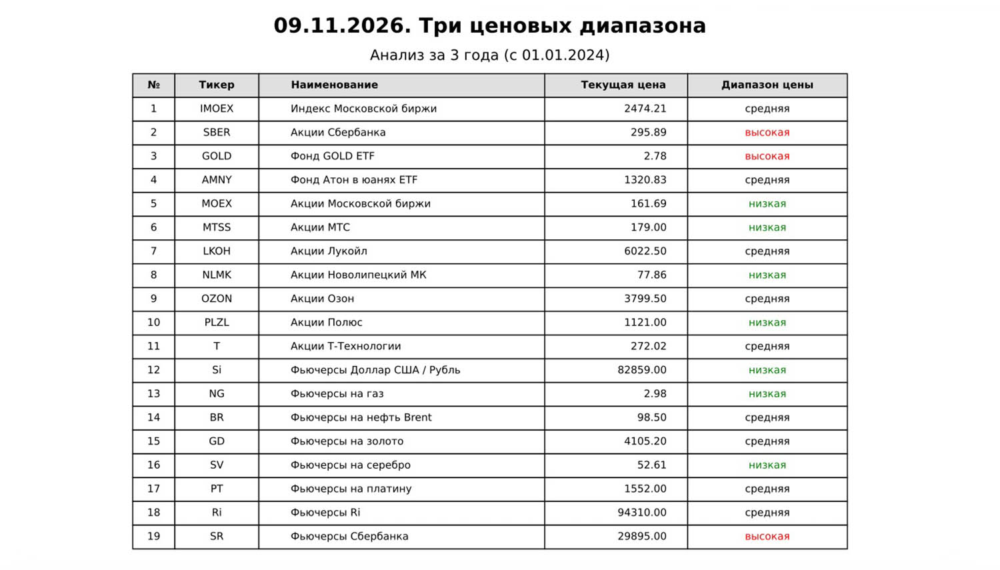
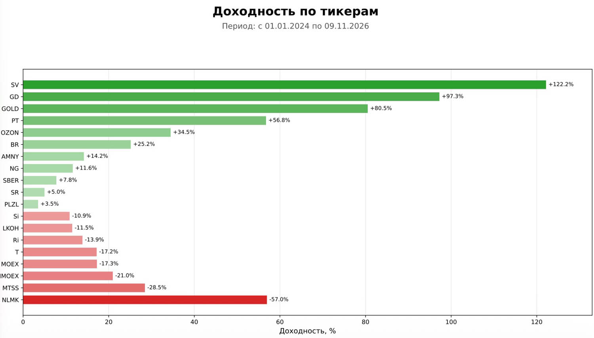
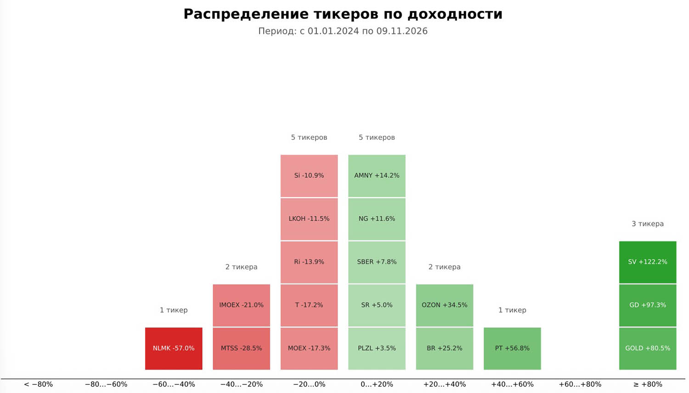
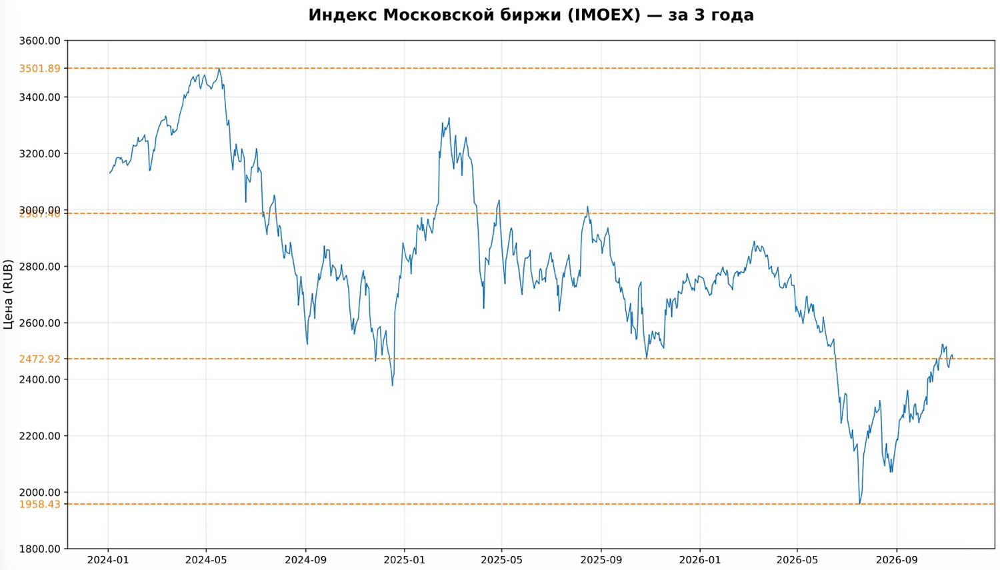

<div align="center">

**🇷🇺 Русский • [🇬🇧 English](./README.md)**

</div>

# Три цены (3price)

**Информация, сгенерированная с помощью данного программного кода (алгоритмов), не является индивидуальной инвестиционной рекомендацией. Финансовые решения вы принимаете самостоятельно и на свой страх и риск.**

*Программный код предоставляется на условиях „как есть“ (as is), без каких-либо гарантий, явных или подразумеваемых, включая, но не ограничиваясь, гарантиями товарной пригодности, соответствия конкретным целям и отсутствия нарушений. Ни при каких обстоятельствах авторы или правообладатели не несут ответственности за любые убытки, ущерб или иные требования, возникшие в результате использования данного программного кода.*

Код создан с использованием LLM (Large Language Model) ассистента.


Система анализа цены финансовых активов: для каждого инструмента определяется, в какой
из **трёх ценовых диапазонов** попадает его текущая цена, рассчитывается доходность
за период и собирается PDF-отчёт с итоговой таблицей и графиками. В Config указаны
тикеры и описания активов выбранного рынка: Московской биржи (`COUNTRY = 'RF'`)
или бирж США (`COUNTRY = 'USA'`).

Код может быть использован для анализа любых финансовых активов путем изменения тикера и его описания. В папке txt должны быть скаченные для этого актива данные (при `DOWNLOAD_MOEX = True`
или `DOWNLOAD_USA = True` система скачивает их сама для выбранного рынка).
Пошаговая инструкция — в разделе «Добавление актива для скачивания и анализа».

## Оглавление

- [Примеры из отчета](#-примеры-из-отчета)
- [Состав проекта](#состав-проекта)
- [Требования и запуск](#требования-и-запуск)
- [Модули](#модули)
- [Настраиваемые параметры](#настраиваемые-параметры)
- [Добавление актива для скачивания и анализа](#добавление-актива-для-скачивания-и-анализа)
- [Сигналы пересечения уровней (ALERTS)](#сигналы-пересечения-уровней-alerts)
- [Формат входных данных](#формат-входных-данных)
- [Выходные файлы](#выходные-файлы)
- [Диагностика частых проблем](#диагностика-частых-проблем)

## 🖼️ Примеры из отчета

<div align="center">
&nbsp;
</div>
<div align="center">
&nbsp;
</div>

Логика «Трёх цен» проста:

1. Берётся история закрытий за период анализа — всего `YEARS` календарных лет,
   включая текущий: с 1 января года `(текущий − (YEARS − 1))` по сегодняшний день.
2. По этой истории считаются минимум и максимум цены; диапазон `[min … max]`
   делится на три равные части уровнями `min + ⅓·range` и `min + ⅔·range`.
3. Текущая цена (последняя доступная дата) классифицируется:

   | Условие              | Метка     | Цвет в таблице |
   |----------------------|-----------|----------------|
   | цена ≤ ⅓ диапазона   | `низкий`  | зелёный        |
   | цена ≤ ⅔ диапазона   | `средний` | чёрный         |
   | цена выше ⅔ диапазона| `высокий` | красный        |

   Если в данных нет ни одной валидной цены, ставится метка `—` серым цветом.

Идея — грубая, но наглядная оценка того, насколько «дорого» выглядит инструмент
относительно собственной многолетней истории, без привязки к фундаменталу.

---

## Состав проекта

```
3price/
├── main.py           # точка входа: только оркестрация
├── config.py         # все настраиваемые параметры и список активов
├── log_setup.py      # настройка логирования и стартовый баннер
├── data_loader.py    # чтение котировок из txt/ → {тикер: DataFrame}
├── analysis.py       # уровни «трёх цен» и цветовые метки (чистые функции)
├── alerts.py         # сигналы пересечения уровней из ALERTS_LEVEL
├── report.py         # PDF: титул с таблицей, доходность, распределение, графики
├── moex_loader.py    # загрузка свежих котировок с MOEX ISS в txt/ (см. DOWNLOAD_MOEX)
├── usa_loader.py     # загрузка свежих котировок США с Yahoo Finance в txt/ (см. DOWNLOAD_USA)
├── txt/              # ВХОДНЫЕ данные — файлы котировок (при DOWNLOAD_MOEX / DOWNLOAD_USA обновляются сами)
├── logs/             # логи запусков (создаётся автоматически)
├── reports/          # готовые PDF (создаётся автоматически)
└── docs/             # иллюстрации для README
```

---

## Требования и запуск

- Python **3.10+** (используется синтаксис `str | None`, `dict[str, ...]`).
- Библиотеки: `pandas`, `matplotlib`; для загрузки данных с MOEX — `requests`,
  с Yahoo Finance — `yfinance`:

  ```bash
  pip install pandas matplotlib requests yfinance
  ```

Запуск — из папки проекта:

```bash
python3 main.py
```

Что произойдёт при запуске:

1. Считаются параметры запуска (даты, имена файлов) — см. `config.py`.
2. Настроятся логи (файл + консоль) и будет напечатан стартовый баннер.
3. Если включён флаг загрузки текущей страны (`DOWNLOAD_MOEX` или
   `DOWNLOAD_USA`) — свежие котировки будут скачаны в `txt/` (полная загрузка
   MOEX ≈2,5 минуты; при сбоях прежние файлы сохраняются).
4. Из папки `txt/` будут прочитаны котировки, отфильтрованы по дате начала.
5. По каждому тикеру рассчитаются уровни и метки диапазонов, доходность за
   период и распределение тикеров по диапазонам.
6. В `reports/` запишется PDF; папки `logs/` и `reports/` создаются автоматически.

Коды возврата: `0` — отчёт построен; `1` — после фильтрации не осталось ни одного
тикера (в лог пишется `[ERROR] Нет данных для сохранения в PDF…`).

Пример вывода в консоль:

```
[INFO] Успешно прочитан файл: RF-SBER-d.txt (729 строк начиная с 2024-01-01)
[ERROR] В файле RF-OZON-d.txt не найдены колонки даты или цены. Доступные: ['foo', 'bar']
[INFO] Проанализировано: 20 тикеров

================================================
[2026-11-13 10:00:00] 🚀 Запуск системы "Три цены" 3price.
================================================
[2026-11-13 10:00:02] ✅ Готово: 2026-11-13-3price-RF-3.pdf — сохранён в папке reports
```

(Строки лога дублируются и в файл, и в консоль; порядок в примере может отличаться
из-за буферизации stdout при перенаправлении вывода.)

---

## Модули

### `main.py` — точка входа

Последовательность шагов: `build_run_params()` → `setup_logging()` → `write_banner()`
→ выбор списка активов и источника загрузки по `COUNTRY` (`'RF'` →
`ASSETS_CONFIG_RF` + `DOWNLOAD_MOEX`/`moex_loader`, `'USA'` → `ASSETS_CONFIG_USA`

- `DOWNLOAD_USA`/`usa_loader`; неизвестное значение — выход с кодом 1) → при
включённом флаге загрузки текущей страны — `download_…_data()` → `load_data()`
→ `build_price_maps()` → при пустых данных ранний выход с кодом 1
→ `generate_pdf()` → финальная строка «Готово» в лог и консоль.
Модуль безопасно импортируется — никакой код не выполняется при `import main`.

### `config.py` — конфигурация

Все константы проекта и словари активов `ASSETS_CONFIG_RF` / `ASSETS_CONFIG_USA`
(выбирается по `COUNTRY`). Функция
`build_run_params()` собирает `RunParams` (именованный набор параметров запуска:
`years`, `today_str`, `pdf_filename`, `log_filename`, `start_date`) и больше ничего
не делает побочного. Период анализа — всего `YEARS` календарных лет, включая
текущий: дата начала считается как `1 января (текущий год − (YEARS − 1))`.

### `log_setup.py` — логирование

- `setup_logging(logs_folder, log_filename)` — создаёт папку логов, настраивает
  одновременный вывод в файл (UTF-8) и консоль, формат `[УРОВЕНЬ] сообщение`,
  возвращает путь к лог-файлу.
- `write_banner(log_path)` — стартовый баннер «🚀 Запуск системы "Три цены"»,
  который пишется в лог **без** стандартного префикса logging.

### `moex_loader.py` — загрузка данных с MOEX

Порт логики проекта `download_moex`. Включается флагом `DOWNLOAD_MOEX` в
`config.py`; свежие котировки записываются в `txt/` с префиксом страны
(`COUNTRY`, например `RF-SBER-d.txt`) и в том же формате (TAB:
`Date, Open, High, Low, Close, Volume_lot, Ticker`), после чего читаются
`data_loader` как обычно.

- Квартальные фьючерсы `Si, CR, Ri, GD, SV, PT, SR, GZ` — «календарная склейка»:
  контракты вида `ТИКЕР + H/M/U/Z + цифра года` скачиваются по отдельности и
  склеиваются в непрерывный ряд по датам экспирации (третий четверг месяца) →
  `COUNTRY-ТИКЕР-d.txt` (например `RF-Si-d.txt`).
- Месячные товарные фьючерсы `NG, BR` — «динамическая склейка» по последнему
  дню торгов каждого контракта → `COUNTRY-ТИКЕР-d.txt` (например `RF-BR-d.txt`).
- Акции, фонды и индекс — дневные свечи (`interval=24`); для индекса `IMOEX`
  используется эндпоинт `markets/index`, для остальных — `markets/shares` →
  `COUNTRY-ТИКЕР-d.txt` (например `RF-SBER-d.txt`).
- Обрабатываются только тикеры из `ASSETS_CONFIG_RF` (классификация
  «квартальный / месячный / акция» задана списками в `config.py`).
- Надёжность: сессия с повторами при 429/5xx; сбой по одному тикеру не
  останавливает загрузку остальных; пустой результат не перезаписывает файл —
  в `txt/` остаются прежние данные, и отчёт строится по ним.
- Архив фьючерсов MOEX ISS отстаёт примерно на день (акции — по сегодняшний
  день, фьючерсы — до предыдущего торгового дня). Полная загрузка ≈2,5 минуты.
- Глубина выгрузки — `DOWNLOAD_FROM` (общая для обоих рынков, по умолчанию
  `'2021-01-01'`), с запасом относительно `YEARS`: период анализа отсекается
  позже по `start_date`.
- Без пакета `requests` проект остаётся рабочим при `DOWNLOAD_MOEX = False` —
  данные тогда берутся из `txt/` как есть.

### `usa_loader.py` — загрузка данных рынка США (Yahoo Finance)

Порт проекта `download_us`. Включается флагом `DOWNLOAD_USA` в `config.py`,
только при `COUNTRY = 'USA'`; котировки скачиваются пакетом `yfinance` с
Yahoo Finance и записываются в `txt/` с префиксом страны и в том же формате,
что и файлы MOEX — TAB (`Date, Open, High, Low, Close, Volume_lot, Ticker`),
после чего читаются `data_loader` как обычно.

- Активы из `ASSETS_CONFIG_USA`: акции и ETF — дневные свечи OHLCV
  (нерегулированная цена `Close`) → `COUNTRY-ТИКЕР-d.txt` (например
  `USA-NVDA-d.txt`).
- Непрерывные фьючерсы Yahoo (ключ в списке активов с суффиксом `=F`, например
  `'ZW=F'`) скачиваются как есть, а сохраняются под очищенным именем →
  `COUNTRY-ZW-F-d.txt` (склейку в непрерывный ряд делает сам Yahoo; в
  отчёте актив значится `ZW=F`).
- Глубина выгрузки — `DOWNLOAD_FROM` (общая с MOEX, по умолчанию `'2021-01-01'`).
- Надёжность: сбой по одному тикеру не останавливает остальные; пустой
  результат не перезаписывает файл — прежние данные остаются в `txt/`.
- Yahoo Finance должен быть доступен из вашей сети; без пакета `yfinance`
  проект остаётся рабочим при `DOWNLOAD_USA = False` — данные тогда берутся
  из `txt/` как есть.

### `data_loader.py` — загрузка данных

- `load_data(txt_folder, assets_config, start_date, country)` — главная функция;
  возвращает `{тикер: DataFrame}` с колонками `begin` (дата) и `close` (цена
  закрытия). Читаются только файлы с префиксом страны: `COUNTRY-ТИКЕР-d.txt`.
- `_extract_ticker(file_name, country)` — тикер из имени файла: часть между
  префиксом страны (`RF-`) и суффиксом `-d.txt`
  (например `RF-SBER-d.txt` → `SBER`). Для непрерывного фьючерса Yahoo
  возвращается исходный тикер: `USA-ZW-F-d.txt` → `ZW=F`.
- `_parse_price_file(file_path)` — чтение одного файла:
  - разделитель определяется автоматически (`sep=None, engine='python'`), поэтому
    подойдут и TAB, и запятая, и точка с запятой;
  - имена колонок приводятся к нижнему регистру, угловые скобки снимаются
    (`<DATE>` → `date`);
  - колонка даты ищется по кандидатурам `begin`, `date`, `timestamp`, `time`;
    колонка цены — по `close`, `last`, `price`;
  - даты парсятся `pd.to_datetime`, цены — `pd.to_numeric`, строки с NaN
    отбрасываются, данные сортируются по дате, цены округляются до 2 знаков.

Правила обработки проблемных файлов (система никогда не падает на одном файле):

| Ситуация | Реакция |
| --- | --- |
| Тикера нет в списке активов выбранной страны | файл **молча** пропускается |
| Не найдены колонки даты/цены | `[ERROR] … не найдены колонки даты или цены. Доступные: [...]` |
| Прочая ошибка чтения/парсинга | `[ERROR] Ошибка обработки <файл>: <текст>` |
| После фильтра по дате пусто | `[WARNING] Файл … не содержит данных после …` |

Для одного тикера в `txt/` теперь ровно одно имя файла `RF-ТИКЕР-d.txt` —
акции и склеенные фьючерсы не различаются суффиксом. Файлы без префикса
страны (`SBER-d.txt`, а также старые имена `SBER-d-5y.txt` и
`SBER-all-d.txt`) не читаются — в лог пишется предупреждение с подсказкой,
как их переименовать.

### `analysis.py` — уровни и метки

Чистые функции без I/O, удобно накрывать тестами:

- `compute_levels(df)` → `(min, min+⅓·range, min+⅔·range, max)` — **единственная**
  формула уровней в проекте; её используют и метки, и пунктирные линии графиков.
- `classify_price(current_price, levels)` → `(метка, цвет)` — правило из таблицы
  выше; границы ⅓ и ⅔ включаются в нижний/средний диапазон.
- `build_price_maps(data_dict)` → `(price_level_map, price_color_map)` — метки и
  цвета сразу по всем тикерам.

### `alerts.py` — сигналы пересечения уровней

`find_signals(data_dict, assets_config, alerts_level, alerts_days)` — возвращает
строки таблицы «Уровни» по всем парам «тикер, уровень» из `alerts_level`:
дата самого свежего пересечения уровня ценой закрытия за период данных и
признак актуальности (пересечение в последние `alerts_days` календарных
дней). Тикер вне списка активов выбранной страны пропускается молча (уровни
можно задавать для обоих рынков); тикер из списка без данных — с `[WARNING]`
в логе. Вызывается из `report.py` и только при `ALERTS = True`.

### `report.py` — PDF-отчёт

- `generate_pdf(pdf_path, ...)` — публичная точка: титульные страницы с таблицей
  тикеров, страница доходности, страница распределения, затем по странице на
  тикер **строго в порядке списка активов выбранной страны**.
- `_build_table_rows(...)` / `_render_title_pages(...)` — таблица
  `№ / Тикер / Наименование / Текущая цена / Диапазон цены`; текст в последней
  колонке окрашен зелёным/чёрным/красным/серым по результатам анализа. Строки
  нарезаются по `ROWS_PER_PAGE = 20`: если тикеров больше двадцати, таблица
  переносится на следующие страницы без заголовка.
- `_render_levels_pages(...)` / `_build_levels_figure(...)` — таблица «Уровни»
  после титульной при `ALERTS = True` (выводится всегда): все пары «тикер,
  уровень» из `ALERTS_LEVEL` выбранной страны, колонки
  `№ / Тикер / Наименование / Дата пересечения уровня / Цена Уровня /
  Текущая цена / Актуальность`; оформление — как у титульной таблицы,
  шапка по центру, заголовок «Уровни» — только на первой странице раздела.
- `_render_returns_page(...)` / `_build_returns_figure(...)` — страница «Доходность
  по тикерам»: горизонтальные столбцы по всем тикерам за период, отсортированные
  по убыванию; длина столбца — по модулю доходности, знак виден в подписи
  «+x.x%»; прибыль окрашена зелёным, убыток — красным, насыщенность растёт с
  удалением от нуля (минимальная — `SAT_MIN`).
- `_render_distribution_page(...)` / `_build_distribution_figure(...)` — страница
  «Распределение тикеров по доходности»: 10 диапазонов по 20% (от `< −80%` до
  `≥ +80%`), в каждом столбце — подписанные ячейки тикеров, над столбцом —
  счётчик (`plural_tickers`); цвет ячейки — та же шкала.
- `_render_ticker_chart(...)` — график цены цветной линией; уровни
  `min, ⅓, ⅔, max` показаны оранжевым пунктиром (`--`), и эти же значения
  выделены оранжевым на оси Y. При `ALERTS = True` дополнительно уровни
  `ALERTS_LEVEL` — серым пунктиром, их значения — серым на оси Y; далёкие
  от цены уровни шкалу не растягивают.
- `plural_years(n)` — склонение «год/года/лет» с учётом исключений 11–14
  (одна функция на весь проект — на титуле и в заголовках графиков).
- `plural_tickers(n)` — склонение «тикер/тикера/тикеров» (счётчики на странице
  распределения).
- `_return_color(v, vmax, vmin)` — единая зелёно-красная шкала насыщенности для
  страниц доходности и распределения.
- `assign_chart_colors(...)` — цвета линий раздаются тикерам по кругу из
  `BASE_COLORS` в порядке списка активов.

---

## Настраиваемые параметры

Все задаваемые параметры проекта — в одной таблице; задаются только в
`config.py` (настройки запуска, списки активов, сигналы, константы
оформления, параметры загрузки MOEX).
Актуальные значения — в `config.py` проекта.

| Параметр | Где задан | По умолчанию | Что задаёт |
| --- | --- | --- | --- |
| `YEARS` | `config.py` | `3` | Глубина анализа в годах: всего `YEARS` календарных лет, включая текущий — период «с 1 января (текущий год − (YEARS − 1))». Влияет на фильтрацию данных, подзаголовок титула, заголовки графиков и имя PDF (`…-3price-RF-N.pdf`). |
| `COUNTRY` | `config.py` | `'RF'` | Рынок анализа: `'RF'` — российский рынок (MOEX), `'USA'` — рынок США (Yahoo Finance). Также задаёт префикс страны в именах файлов: `txt/RF-…` / `txt/USA-…`, `reports/…-3price-RF-N.pdf`. |
| `DOWNLOAD_MOEX` | `config.py` | `True` | `True` — перед построением отчёта скачать свежие котировки с MOEX ISS в `txt/` (при `COUNTRY = 'RF'`, см. `moex_loader.py`); `False` — работать только с файлами в `txt/`, без сети. |
| `QUARTERLY_FUTURES` | `config.py` | 8 тикеров | Квартальные фьючерсы MOEX — «календарная склейка» по датам экспирации; тикер вне списков фьючерсов качается как акция (см. «Добавление актива»). |
| `QUARTERLY_MONTHS` | `config.py` | `H/M/U/Z` → 3/6/9/12 | Коды месяцев квартальных контрактов и их номера — расчёт дат экспирации. |
| `MONTHLY_FUTURES` | `config.py` | 2 тикера | Месячные товарные фьючерсы MOEX — «динамическая склейка» по последнему дню торгов контракта. |
| `MONTHLY_CODES` | `config.py` | `F…Z` (12 кодов) | Коды месяцев месячных контрактов. |
| `REQUEST_TIMEOUT`, `MAX_RETRIES`, `MAX_PAGES`, `PAGE_SIZE_THRESHOLD` | `config.py` | 15 / 3 / 500 / 100 | Сетевые настройки загрузки MOEX ISS: таймаут запроса (сек), повторы при 429/5xx, лимит страниц пагинации, порог размера страницы. |
| `DOWNLOAD_USA` | `config.py` | `False` | `True` — перед построением отчёта скачать свежие котировки США с Yahoo Finance в `txt/` (при `COUNTRY = 'USA'`, см. `usa_loader.py`); `False` — работать только с файлами в `txt/`, без сети. |
| `DOWNLOAD_FROM` | `config.py` | `'2021-01-01'` | Глубина выгрузки, общая для обоих рынков (MOEX и Yahoo Finance): файлы в `txt/` пишутся от этой даты. Держите запас относительно `YEARS` — период анализа отсекается позже по `start_date`. |
| `TXT_FOLDER` | `config.py` | `'txt'` | Папка с входными файлами котировок. |
| `LOGS_FOLDER` | `config.py` | `'logs'` | Папка для логов (создаётся автоматически). |
| `REPORTS_FOLDER` | `config.py` | `'reports'` | Папка для PDF-отчётов (создаётся автоматически). |
| `ASSETS_CONFIG_RF` | `config.py` | 20 тикеров | Список активов RF, используется при `COUNTRY = 'RF'` — см. ниже. |
| `ASSETS_CONFIG_USA` | `config.py` | 28 тикеров | Список активов США, используется при `COUNTRY = 'USA'` — см. ниже. |
| `ALERTS` | `config.py` | `True` | Выключатель сигналов пересечения уровней: `True` — искать пересечения `ALERTS_LEVEL`, выводить таблицу «Уровни» на титуле и рисовать уровни на графиках; `False` — функционал выключен, отчёт как раньше. |
| `ALERTS_DAYS` | `config.py` | `10` | Окно поиска сигналов, календарных дней от последней даты данных тикера. |
| `ALERTS_LEVEL` | `config.py` | — | Уровни цены для отслеживания: `{тикер: [уровень, …]}`, тикеры — из списка активов выбранной страны. Пересечение уровня ценой закрытия — сигнал (см. «Сигналы пересечения уровней»). |
| `ALERTS_LEVEL_COLOR` | `config.py` | `'gray'` | Цвет уровней `ALERTS_LEVEL` на графиках тикеров (пунктир и метки на оси Y). |
| `LEVEL_COLOR` | `config.py` | `'#ff7f0e'` | Оранжевый цвет пунктирных уровней и их подписей на оси Y. |
| `BASE_COLORS` | `config.py` | 10 цветов | Палитра цветов линий графиков; при большем числе тикеров цвета повторяются по кругу. |
| `ROWS_PER_PAGE` | `config.py` | `20` | Строк данных таблицы тикеров на одной титульной странице (остальное переносится на следующую). |
| `SAT_MIN` | `config.py` | `0.35` | Минимальная насыщенность цвета на страницах доходности и распределения: у нуля цвет бледный, но различимый. |
| `GREEN_BASE`, `RED_BASE` | `config.py` | `#2ca02c` / `#d62728` | Базовые зелёный/красный цвета шкалы доходности. |

### Списки активов `ASSETS_CONFIG_RF` / `ASSETS_CONFIG_USA`

Оба списка — словари одного вида; в отчёт попадает тот, что выбран `COUNTRY`:

```python
'SBER': {'name': 'Акции Сбербанка', 'currency': 'RUB'},
'NG':   {'name': 'Фьючерсы на газ', 'currency': 'USD'},
```

- Ключ — **тикер**, который должен в точности совпадать с тикер-частью имени
  файла в `txt/` — между префиксом страны (`RF-` / `USA-`) и суффиксом
  `-d.txt` (регистр важен: `Si` ≠ `SI`).
- `name` — человекочитаемое наименование для таблицы и заголовков графиков.
- `currency` — подпись оси Y графика (`Цена (RUB)` / `Цена (USD)`). Пересчёт
  валют **не выполняется**: фьючерсы `NG`, `BR`, `GD`, `SV`, `PT` показываются
  в долларах, как есть в данных.

**Как добавить актив** — пошагово в разделе «Добавление актива для скачивания
и анализа» ниже. Убрать актив из отчёта — удалить строку из словаря (файл в
`txt/` после этого просто игнорируется).

### Порядок вывода активов

**Порядок вывода активов (сортировка).** Порядок ключей словаря — единственный
определитель порядка; никакая автоматическая сортировка (по алфавиту, по
доходности и т.п.) не выполняется. Он задаёт:

- порядок строк таблицы на титуле;
- порядок страниц с графиками (по одной на актив);
- раздачу цветов линий из `BASE_COLORS` по кругу.

Чтобы поменять порядок — переставьте строки в словаре в `config.py`. Две
страницы отчёта сортируются по-своему: «Доходность по тикерам» — по значению
доходности (по убыванию), «Распределение тикеров по доходности» — по диапазонам.

### Что считается автоматически (не настраивается)

- `start_date` — 1 января года `(текущий − (YEARS − 1))`;
- имя PDF — `ГГГГ-ММ-ДД-3price-RF-N.pdf` (с префиксом `COUNTRY`) по дате запуска;
- имя лога — `ГГГГ-ММ-3price.log` по месяцу запуска;
- цвета меток диапазона (зелёный/чёрный/красный/серый) — жёстко заданы в
  `analysis.classify_price`; зелёно-красная шкала доходности — в `_return_color`
  из базовых `GREEN_BASE`/`RED_BASE` (заданы в `config.py`).

---

## Добавление актива для скачивания и анализа

Чтобы новый актив появился в отчёте, достаточно двух шагов; для фьючерсов
MOEX нужен ещё и третий.

**Шаг 1. Дописать строку в список активов** (`config.py`) — в словарь
выбранного рынка: `ASSETS_CONFIG_RF` при `COUNTRY = 'RF'` или
`ASSETS_CONFIG_USA` при `COUNTRY = 'USA'`:

```python
'LKOH': {'name': 'Акции Лукойл', 'currency': 'RUB'},
```

- ключ — **тикер источника данных**: тикер MOEX для российского рынка, тикер
  Yahoo для рынка США; он же — тикер-часть имени файла в `txt/` (регистр
  важен: `Si` ≠ `SI`);
- `name` — наименование в таблице и заголовках графиков;
- `currency` — подпись оси Y графика; пересчёт валют не выполняется;
- позиция строки в словаре — порядок актива в отчёте (см. «Порядок вывода
  активов»).

**Шаг 2. Обеспечить данные в `txt/`.** При включённой загрузке выбранного
рынка (`DOWNLOAD_MOEX = True` / `DOWNLOAD_USA = True`) файл котировок
создастся и будет обновляться сам при ближайшем запуске. В ручном режиме
положите файл с таким именем сами — требования к формату в разделе «Формат
входных данных». Имя файла: `COUNTRY-ТИКЕР-d.txt` — и для
акций/фондов/индексов, и для склеенных фьючерсов.
Тикер без файла в отчёт не попадёт — файл ищется строго по имени.

**Шаг 3. Только для фьючерсов MOEX — особенность.** Способ загрузки выбирает
`moex_loader.py` по спискам из `config.py`, а не по словарю активов: всё, что не
попало в списки фьючерсов, считается акцией/фондом/индексом и скачивается
как дневные свечи фондового рынка.

- квартальные фьючерсы — список `QUARTERLY_FUTURES` (`Si, CR, Ri, GD, SV,
  PT, SR, GZ`): «календарная склейка» контрактов
  `ТИКЕР+H/M/U/Z+цифра года` по датам экспирации → `RF-ТИКЕР-d.txt`;
- месячные товарные — список `MONTHLY_FUTURES` (`NG, BR`): «динамическая
  склейка» по последнему дню торгов каждого контракта → `RF-ТИКЕР-d.txt`;
- всё остальное — дневные свечи → `RF-ТИКЕР-d.txt`.

Поэтому новый фьючерс MOEX добавляется в **два места**: строку в
`ASSETS_CONFIG_RF` и код тикера — в `QUARTERLY_FUTURES` или
`MONTHLY_FUTURES` в `config.py`. Если ограничиться словарём активов,
загрузчик пойдёт за свечами на фондовый рынок, вернёт пустой результат
(`[WARNING] MOEX: нет данных для …` в логе) и файл в `txt/` не создастся —
тикер не появится в отчёте.

**Фьючерс рынка США** (непрерывный контракт Yahoo) задаётся ключом с
суффиксом `=F`, например `'ZW=F'`; файл сохраняется под очищенным именем
`USA-ZW-F-d.txt`, а в отчёте актив значится как `ZW=F`. Дополнительно
ничего вписывать не нужно — выбор «фьючерс или акция» делает суффикс `=F`
в ключе.

**Уровни для сигналов** (необязательно): чтобы по новому активу искались
пересечения, допишите его в `ALERTS_LEVEL` — см. «Сигналы пересечения
уровней».

---

## Сигналы пересечения уровней (ALERTS)

При `ALERTS = True` система отслеживает ценовые уровни из `ALERTS_LEVEL` —
словаря вида `{тикер: [уровень, ...]}`:

```python
ALERTS_LEVEL = {
    'SBER': [280.0, 320.0],   # один тикер — несколько уровней
    'NG':   [4.0],
}
```

- Сигнал — пересечение уровня **ценой закрытия** снизу вверх или сверху вниз;
  достижение уровня (закрытие ровно на уровне) тоже считается сигналом.
- Для каждой пары «тикер — уровень» берётся самое свежее пересечение за
  период данных — его дата идёт в колонку «Дата пересечения уровня»
  (данные дневные; время появится автоматически, если будет в данных).
- «Актуальность» — `Да`, если свежайшее пересечение случилось в последние
  `ALERTS_DAYS` календарных дней от последней даты данных тикера, иначе
  `Нет` (`Да` выводится зелёным); уровень, который цена ни разу не
  пересекала за период, получает в дате `—` и `Нет`.
- Учитываются только тикеры `ALERTS_LEVEL`, входящие в список активов
  выбранной страны (`COUNTRY`); тикеры другого рынка пропускаются молча,
  тикер из списка без данных — с `[WARNING]` в логе.

Что меняется в отчёте (только при `ALERTS = True`):

- после титульной таблицы всегда выводится таблица **«Уровни»** (оформление —
  как у титульной, шапка по центру) со строками по всем тикерам из
  `ALERTS_LEVEL` выбранной страны и колонками `№ / Тикер / Наименование /
  Дата пересечения уровня / Цена Уровня / Текущая цена / Актуальность`;
- внизу страницы «Уровни» выводится примечание «Уровень считается актуальным,
  если пересечение произошло в течение последних `ALERTS_DAYS` дней» — число
  подставляется из `config.py`; при переносе таблицы на несколько страниц
  примечание печатается только на последней из них;
- на графиках тикеров уровни `ALERTS_LEVEL` рисуются серым пунктиром, их
  значения выделены серым на оси Y (в стиле уровней `min / ⅓ / ⅔ / max`);
  уровни, далёкие от диапазона цены, шкалу графика не растягивают.

При `ALERTS = False` сигналов нет: отчёт формируется как раньше — ни таблицы
«Уровни», ни уровней на графиках.

---

## Формат входных данных

Имя файла в `txt/`: `RF-ТИКЕР-d.txt` для российского рынка и
`USA-ТИКЕР-d.txt` для рынка США (префикс = значение `COUNTRY`). Суффикс
`-d.txt` единый для всех типов активов — акции, фонды, индексы и склеенные
фьючерсы (непрерывный фьючерс Yahoo `ZW=F` сохраняется как `USA-ZW-F-d.txt`).

Оба загрузчика пишут один и тот же формат — текстовый CSV с табуляцией:

```
Date Open High Low Close Volume_lot Ticker
2026-11-02 342.67 343.8 335.82 338.32 64757700 AAPL
```

При `DOWNLOAD_MOEX = True` (MOEX ISS) или `DOWNLOAD_USA = True` (Yahoo Finance)
файлы обновляются автоматически. В ручном режиме достаточно текстового CSV с
любым разделителем и двумя обязательными колонками — дата и цена закрытия
(кандидаты перечислены в описании `data_loader.py`); остальные колонки
(`Open`, `High`, …, `Ticker`) допустимы и игнорируются.

Требования к содержимому:

- даты — в любом формате, понимаемом `pandas.to_datetime` (`2020-01-06`,
  `06.01.2020`, `20200106` и т.п.);
- цены — числа; строки с пустыми/нечисловыми значениями отбрасываются;
- достаточно данных от `start_date` — всё раньше отфильтруется, но если после
  фильтра не останется ни одной строки, тикер не попадёт в отчёт
  (`[WARNING]` в логе);
- данные до `start_date` в файле не мешают — они отсекаются при загрузке.

Файлы c данными можно скачать программой `download_moex` (RF) и скопировать в
папку `txt` — либо доверить загрузку самой системе (`DOWNLOAD_MOEX = True` /
`DOWNLOAD_USA = True`).

## Выходные файлы

### `reports/ГГГГ-ММ-ДД-3price-RF-N.pdf`

- Страница 1 — титул: заголовок с датой, подзаголовок «Анализ за N лет (с …)»,
  таблица `№ / Тикер / Наименование / Текущая цена / Диапазон цены` с окрашенной
  меткой диапазона. Если тикеров больше 20, таблица продолжается на следующих
  страницах (без заголовка).
- Только при `ALERTS = True` — таблица «Уровни» по всем парам «тикер —
  уровень» из `ALERTS_LEVEL` выбранной страны: дата последнего пересечения,
  текущая цена и «Актуальность» (`Да` — пересечение в последние
  `ALERTS_DAYS` дней, иначе `Нет`); вставляется сразу после титула, поэтому
  нумерация последующих страниц сдвигается. См. «Сигналы пересечения
  уровней».
- Страница 2 — «Доходность по тикерам»: горизонтальные столбцы по всем тикерам
  за период (сортировка по убыванию; прибыль — зелёным, убыток — красным;
  насыщенность растёт с удалением от нуля), подписи «+x.x%» у столбцов.
- Страница 3 — «Распределение тикеров по доходности»: 10 диапазонов по 20%
  (от `< −80%` до `≥ +80%`), в каждом столбце — подписанные ячейки тикеров,
  над столбцом счётчик тикеров.
- Далее по одной странице на тикер (в порядке списка активов выбранной страны): график цены за
  период с оранжевыми пунктирными уровнями `min / ⅓ / ⅔ / max`; при
  `ALERTS = True` на графике дополнительно уровни `ALERTS_LEVEL` — серым
  пунктиром.

### `logs/ГГГГ-ММ-3price.log`

Полный журнал запусков за месяц: баннеры запуска, строки чтения файлов
(сколько строк прочитано и с какой даты), ошибки и предупреждения, итоговая
строка «✅ Готово: …». Лог дополняется при каждом запуске.

---

## Диагностика частых проблем

| Симптом | Причина и что делать |
| --- | --- |
| `[ERROR] Нет данных для сохранения в PDF` (код возврата 1) | В `txt/` нет файлов с тикерами из списка активов выбранной страны, либо не
создаются папки — проверьте, что запускаете из папки проекта и имена файлов совпадают с тикерами. |
| `MOEX: … сетевая ошибка / HTTP …` при загрузке | Проблемы связи с MOEX ISS: уже скачанные файлы в `txt/` сохраняются, отчёт строится по ним — можно повторить запуск позже. Загрузка включается флагом `DOWNLOAD_MOEX = True`. |
| `USA: … нет данных / ошибка загрузки` при загрузке | Yahoo Finance недоступен из вашей сети (таймаут/блокировка) или тикер неверный: уже скачанные файлы в `txt/` сохраняются, отчёт строится по ним — можно повторить запуск позже. Загрузка включается флагом `DOWNLOAD_USA = True` при `COUNTRY = 'USA'`. |
| `…не найдены колонки даты или цены. Доступные: ['foo', 'bar']` | В файле нет колонки с ожидаемым именем — переименуйте колонку (`<DATE>`/`<CLOSE>` и т.п.) или добавьте свою кандидатиру в список `_parse_price_file` в `data_loader.py`. |
| `Файл … не содержит данных после ГГГГ-ММ-ДД` | В файле нет котировок за период анализа — выгрузите более длинную историю. |
| Тикер есть в `txt/`, но не появился в отчёте | Тикер не добавлен в список активов, либо не совпадает имя/регистр (`Si` ≠ `SI`), либо имя файла не вида `COUNTRY-ТИКЕР-d.txt`. |
| Новый фьючерс MOEX не появился в отчёте / `MOEX: нет данных для …` | Код фьючерса добавлен только в список активов, но не в `QUARTERLY_FUTURES` / `MONTHLY_FUTURES` в `config.py` — загрузчик ищет его среди акций (см. «Добавление актива для скачивания и анализа»). |
| `ALERTS_LEVEL: по тикеру … нет данных — пропущен` | В `ALERTS_LEVEL` указан тикер из списка активов выбранной страны, по которому нет файла в `txt/` — проверьте наличие и имя файла (регистр важен). |
| `ModuleNotFoundError: pandas` | Запуск не тем интерпретатором: библиотеки установлены в конкретный Python (на машине автора — `/usr/local/bin/python3.12`). |
| `ModuleNotFoundError: requests` | Пакет `requests` не установлен, а `DOWNLOAD_MOEX = True`: установите его (`pip install requests`) или выключите загрузку (`DOWNLOAD_MOEX = False`). |
| `ModuleNotFoundError: yfinance` | Пакет `yfinance` не установлен, а `DOWNLOAD_USA = True`: установите его (`pip install yfinance`) или выключите загрузку (`DOWNLOAD_USA = False`). |
